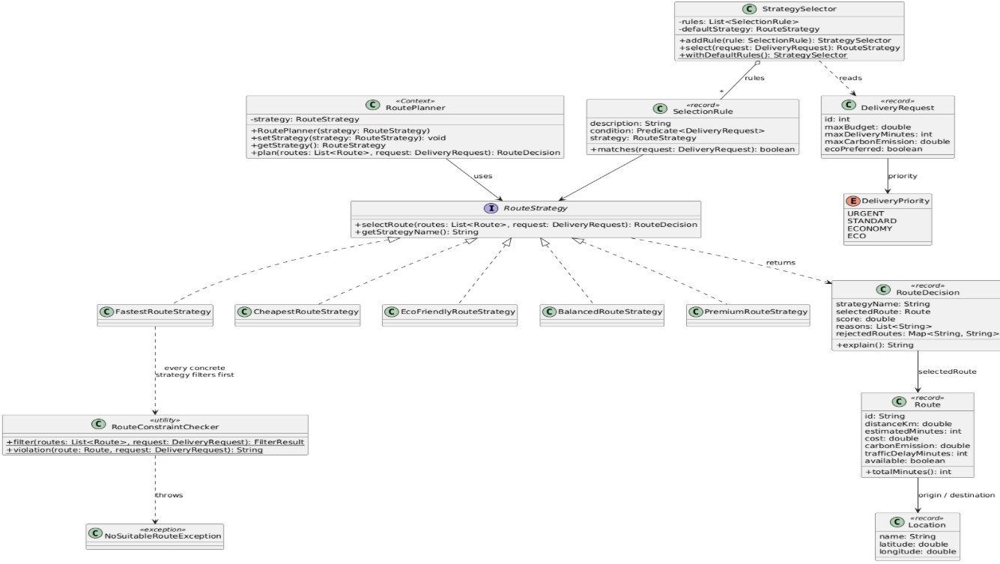
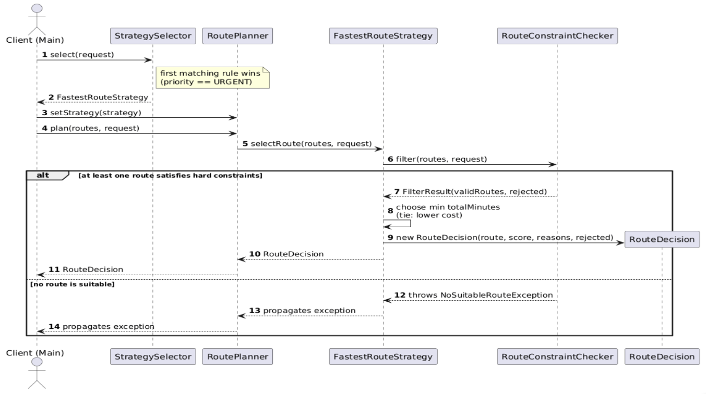

# Smart Delivery & Route Optimization Engine

Assignment 5 — **Strategy Pattern** (Java 17, Maven, JUnit 5).

The engine selects a delivery route from several candidates. There is no single "best" route: an urgent
medical delivery needs the fastest one, an economy delivery the cheapest one, an eco delivery the cleanest one.
Each way of choosing is a separate, interchangeable **Strategy**.

## How to run

```
mvn test                     # run all 43 unit tests
```
Run `kz.delivery.Main` from the IDE to see the full demonstration (runtime switching, automatic selection,
comparison mode, fifth strategy, failure scenarios).

## 1. Architecture

| Role | Class | Package |
|---|---|---|
| **Context** | `RoutePlanner` | `kz.delivery.planner` |
| **Strategy** (interface) | `RouteStrategy` | `kz.delivery.strategy` |
| **Concrete strategies** | `FastestRouteStrategy`, `CheapestRouteStrategy`, `EcoFriendlyRouteStrategy`, `BalancedRouteStrategy`, `PremiumRouteStrategy` | `kz.delivery.strategy` |
| Strategy selection | `StrategySelector`, `SelectionRule` | `kz.delivery.selector` |
| Hard constraints | `RouteConstraintChecker` | `kz.delivery.strategy` |
| Result + explanation | `RouteDecision` | `kz.delivery.strategy` |
| Comparison mode | `StrategyComparator`, `ComparisonResult` | `kz.delivery.comparison` |
| Domain model | `Location`, `Route`, `DeliveryRequest`, `DeliveryPriority` | `kz.delivery.domain` |
| Errors | `NoSuitableRouteException` | `kz.delivery.exception` |

**Interface improvement.** `RouteStrategy.selectRoute` returns a `RouteDecision` (selected route, score, reasons,
rejected routes with reasons) instead of a bare `Route`. This satisfies the "every strategy must explain its result"
requirement without storing state inside strategies, so strategies stay stateless and thread-safe.

**Hard constraints.** A route that is unavailable, over budget, past the deadline or over the emission limit can
never win, however good its score. The check lives in one place (`RouteConstraintChecker`) and is used by every
strategy. If no route passes, `NoSuitableRouteException` is thrown with the rejection reason of every route.

### Strategies and formulas

| Strategy | Rule |
|---|---|
| **Fastest** | minimum `finalTime = estimatedMinutes + trafficDelayMinutes`; tie → cheaper route |
| **Cheapest** | minimum `totalCost = baseCost + distanceKm × costPerKm + baseCost × prioritySurcharge + serviceFee` (defaults: 15 per km, fee 200, surcharge URGENT 20% / STANDARD 5% / ECONOMY 0% / ECO 0%). The budget is checked against the **full** cost; tie → faster route |
| **Eco** | minimum `ecoScore = carbonEmission × emissionWeight + distanceKm × distanceWeight` (defaults 1.0 and 0.05); tie → cheaper route |
| **Balanced** | minimum `score = nTime·wTime + nCost·wCost + nDistance·wDistance + nEmission·wEmission`, where `n*` is min-max normalisation over the valid routes. Weights are configurable and must be non-negative and sum to 1.0 (tolerance 1e-9), otherwise `IllegalArgumentException` |
| **Premium** (5th) | reliability first: minimum traffic delay, then fastest, then cheapest; hard constraints still apply |

### Automatic strategy selection

`StrategySelector` holds an ordered list of `SelectionRule` (condition → strategy). The first matching rule wins,
otherwise the default strategy is used. Default rules: `URGENT → Fastest`, `ecoPreferred → Eco`, `ECO → Eco`,
`ECONOMY → Cheapest`, otherwise `Balanced`. URGENT is checked first so that an urgent delivery is never slowed
down by the eco flag. New business rules are added with `addRule(...)`, without editing the selector.

## 2. UML

### Class diagram


### Sequence diagram (URGENT request → Fastest strategy)


Diagram sources (Mermaid): `docs/class-diagram.mmd`, `docs/sequence-diagram.mmd`.

## 3. Answers to the assignment questions

**1. What problem does Strategy solve in this project?**
Route selection has several interchangeable algorithms (time, cost, emissions, balance, reliability). Strategy puts
each algorithm into its own class behind one interface, so the planner does not contain a growing chain of conditions.

**2. Where is the Context?**
`kz.delivery.planner.RoutePlanner`. It stores a `RouteStrategy` and delegates `plan(...)` to it.

**3. Where is the Strategy interface?**
`kz.delivery.strategy.RouteStrategy`.

**4. What are the Concrete Strategies?**
`FastestRouteStrategy`, `CheapestRouteStrategy`, `EcoFriendlyRouteStrategy`, `BalancedRouteStrategy` and the
additional `PremiumRouteStrategy` (added in a separate commit).

**5. Where is runtime strategy switching demonstrated?**
In `Main.runtimeSwitchingDemo` — one `RoutePlanner` object is switched through four strategies with `setStrategy`.
It is also covered by `RoutePlannerTest.sameInstanceSwitchesAlgorithmsAtRuntime`.

**6. Why is this Strategy rather than simple if/else?**
With if/else, every new algorithm means editing the planner and re-testing all branches, and the algorithms are
mixed in one method. With Strategy each algorithm is isolated, testable on its own and added as a new class.
`RoutePlanner` contains no `if`, `switch` or `instanceof` over strategy types. The choice of strategy is also
data-driven (`SelectionRule`) instead of a hard-coded `switch`.

**7. How can a new Strategy be added?**
1. Create a class implementing `RouteStrategy` (call `RouteConstraintChecker.filter(...)` first, return a `RouteDecision`).
2. Optionally register a rule: `selector.addRule(new SelectionRule("description", condition, new MyStrategy()))`.
3. Optionally pass it to `StrategyComparator`.

`PremiumRouteStrategy` was added exactly this way: **0 existing production classes were modified**, only
the demo `Main` was extended.

**8. What is the difference between Strategy and Bridge in the context of my previous assignment?**
In Assignment 4 (Bridge) there were two independent hierarchies: the abstraction `Notification` with its
refined variants (`UrgentNotification`, `MarketingNotification`, `EncryptedNotification`,
`ScheduledBatchNotification`, `PirateNotification`) and the implementor interface `MessageSender` with its
implementations (`EmailMessageSender`, `SmsMessageSender`, `TelegramMessageSender`, `PushNotificationSender`,
`KafkaEventSender`, `PigeonMessageSender`, ...). `Notification` holds a `MessageSender`, so *what* is sent and
*how/where* it is delivered vary independently: a new notification type or a new channel can be added without
touching the other hierarchy, and without a class explosion of every type × channel combination.

Bridge is structural: it splits one concept into two hierarchies that evolve separately, and the connection is
normally set when the object is created. Strategy is behavioural: it makes one algorithm of the context
replaceable and is meant to be swapped at runtime. Here (`RoutePlanner` + `RouteStrategy`) there is only one
varying part, the route-selection algorithm, and the planner switches it with `setStrategy(...)`, so Strategy fits
better. Structurally both patterns look similar (a class delegates to an interface), but the intent differs:
Bridge decouples an abstraction from its implementation, Strategy chooses an algorithm. If `RoutePlanner` also had
several variants of its own (for example a city planner and an intercity planner) that must vary independently from
the algorithms, then Bridge would be the right choice.

**9. Which SOLID principles are demonstrated?**
- **SRP** — `RoutePlanner` delegates, each strategy implements one algorithm, `StrategySelector` chooses a strategy,
  `RouteConstraintChecker` validates constraints, `StrategyComparator` compares.
- **OCP** — a new strategy or selection rule is a new class or `addRule` call; `RoutePlanner`, `RouteStrategy` and
  `StrategySelector` stay unchanged (see `PremiumRouteStrategy`).
- **DIP** — `RoutePlanner` depends on the `RouteStrategy` abstraction, never on a concrete strategy
  (`RoutePlannerTest.plannerWorksWithAnyRouteStrategyImplementation` uses a stub).
- **LSP** — every strategy honours the same contract: it returns a valid `RouteDecision` or throws
  `NoSuitableRouteException`, so they can replace one another.

**10. What limitation does the current architecture have?**
- Hard constraints are a fixed set inside `RouteConstraintChecker`; adding a new kind of constraint means editing
  that class (partial OCP violation).
- Selection rules are checked linearly and the order is the priority; with many rules, conflicts are not detected.
- Scores of different strategies are not comparable with each other (minutes, money, eco-score, weighted sum).
- Routes are in-memory demo data: there is no real route graph, live traffic or external pricing.
- Cost parameters and eco weights are configured in code, not in an external configuration file.

## 4. Example console output

Runtime switching, request #101 (STANDARD, budget 6000, deadline 60 min) — one `RoutePlanner`, four strategies
(Fastest and Balanced shown):

```
=== RUNTIME STRATEGY SWITCHING (request #101) ===

Strategy: Fastest Strategy
Selected: Route B
Reason:
  Estimated time: 22 min
  Traffic penalty: +5 min
  Final time: 27 min
Route F rejected: Budget exceeded (7500.0 > 6000.0).
Route G rejected: Route is unavailable.

Strategy: Balanced Strategy
Selected: Route H
Reason:
  Time:     normalized 0.355 x weight 0.40 = 0.142
  Cost:     normalized 0.455 x weight 0.30 = 0.136
  Distance: normalized 0.471 x weight 0.10 = 0.047
  Emission: normalized 0.136 x weight 0.20 = 0.027
  Total score: 0.353 (lower is better)
Route F rejected: Budget exceeded (7500.0 > 6000.0).
Route G rejected: Route is unavailable.
```

Automatic selection (`StrategySelector`):

| Request | Priority | Chosen strategy | Route |
|---|---|---|---|
| #201 | URGENT | Fastest | B |
| #202 | ECONOMY (budget 3000) | Cheapest | D (route H rejected: budget exceeded after surcharges) |
| #203 | ECO | Eco | E |
| #204 | STANDARD | Balanced | H |

Comparison mode (same request #105, five strategies):

```
DELIVERY REQUEST #105

Fastest Strategy:
  Route B
  Time: 27 min
  Cost: 4800.00
  CO2: 3.1 kg
  Score: 27.00

Cheapest Strategy:
  Route D
  Time: 58 min
  Cost: 1500.00
  CO2: 2.8 kg
  Score: 2045.00

Eco Strategy:
  Route E
  Time: 50 min
  Cost: 2600.00
  CO2: 0.9 kg
  Score: 1.45

Balanced Strategy:
  Route H
  Time: 38 min
  Cost: 3000.00
  CO2: 1.2 kg
  Score: 0.35

Premium Strategy:
  Route E
  Time: 50 min
  Cost: 2600.00
  CO2: 0.9 kg
  Score: 2.00
```

Failure scenarios:

```
1. Empty route list
  NoSuitableRouteException: No routes were provided.

2. No route fits the budget (100)
  NoSuitableRouteException: No route satisfies the constraints of request #302.
    Route A: Budget exceeded (3200.0 > 100.0).
    ...
    Route G: Route is unavailable.

3. Balanced weights sum to 0.9
  IllegalArgumentException: Weights must sum to 1.0, but the sum is 0.8999999999999999

4. Negative route cost
  IllegalArgumentException: Cost must not be negative: -5.0

5. Missing delivery priority
  IllegalArgumentException: Delivery priority is required
```

Error handling choice: invalid **data** (negative cost, broken weights, missing request fields) fails at object
creation with `IllegalArgumentException`; valid data with **no suitable route** is a business situation and raises
`NoSuitableRouteException` carrying the reason for every rejected route. `null` is never returned.

## 5. Test results

`mvn test` → **Tests run: 43, Failures: 0, Errors: 0, Skipped: 0**

| Test class | Tests | Covers |
|---|---|---|
| `FastestRouteStrategyTest` | 4 | traffic penalty, unavailable route, tie-break, budget changes winner |
| `CheapestRouteStrategyTest` | 4 | cost formula, priority surcharge, budget after surcharges |
| `EcoFriendlyRouteStrategyTest` | 3 | eco score, emission limit, invalid weights |
| `BalancedRouteStrategyTest` | 5 | best compromise, invalid weights, float tolerance, weights change winner, single-route boundary |
| `PremiumRouteStrategyTest` | 3 | fifth strategy, reliability vs speed, hard constraints |
| `RoutePlannerTest` | 3 | runtime switching, stub strategy (DIP), null strategy |
| `StrategySelectorTest` | 6 | priority mapping, rule order, custom rule, end-to-end selection |
| `ConstraintsAndFailuresTest` | 9 | budget/deadline boundaries, no valid route, empty list, negative values, missing data, null element |
| `StrategyComparatorTest` | 6 | comparison of strategies, failing strategy, report, fifth strategy joins comparison |